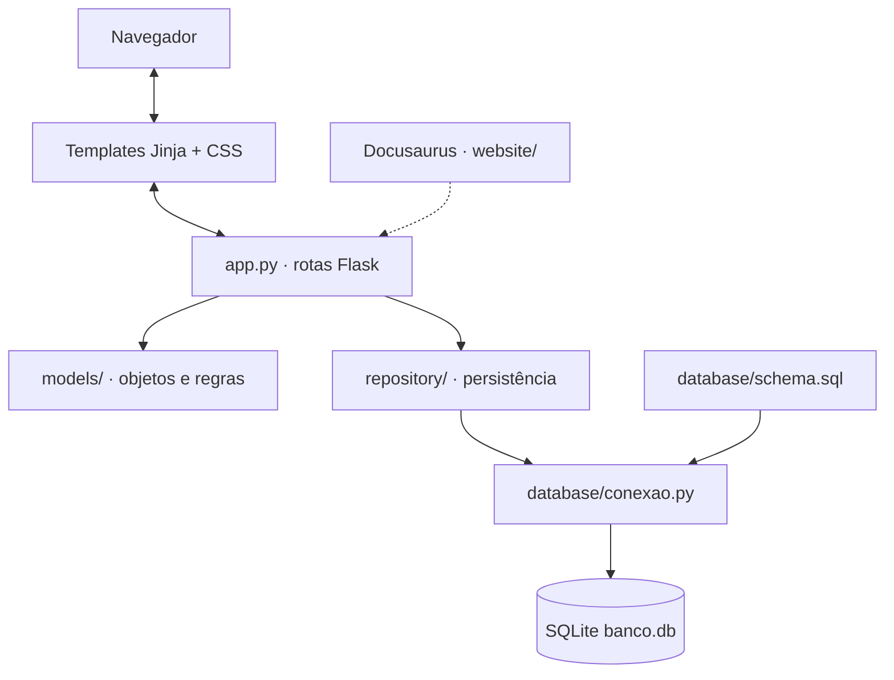
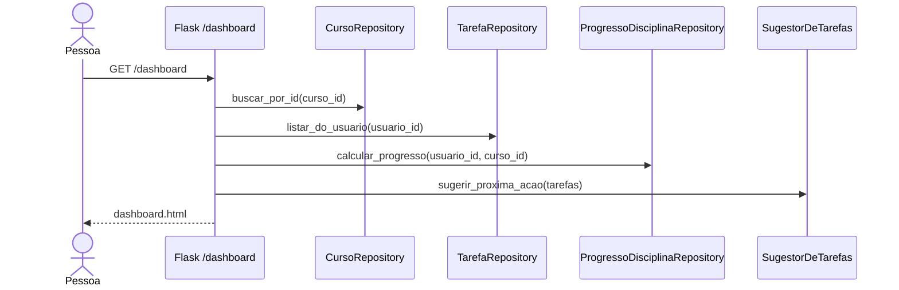

# Arquitetura da aplicação

O MyFlow separa a interface Flask, as regras de negócio das classes de domínio e as consultas dos repositórios. SQLite guarda usuários, cursos, disciplinas, progresso e tarefas. O Docusaurus documenta o projeto e não é parte do processo Flask.

## Estrutura principal

| Caminho | Responsabilidade |
|---|---|
| `app.py` | Rotas, sessão, CSRF, recuperação de senha, administração e composição das telas |
| `models/` | `Usuario`, `Curso`, `Disciplina`, `ProgressoDisciplina`, `Tarefa`, `SugestorDeTarefas` |
| `repository/` | CRUD SQLite de usuários, cursos, disciplinas, progresso individual e tarefas |
| `database/` | Conexões, schema e migrações legadas |
| `templates/` | Telas Jinja de cadastro, login, painel, tarefas, agenda, perfil e administração |
| `static/styles.css` | Aparência da aplicação Flask |
| `tests/` | Testes automatizados para tarefas e regras relacionadas |
| `uml/` | Diagramas PlantUML do projeto |
| `website/` | Documentação Docusaurus responsiva |

## Responsabilidades

- O modelo valida entradas com propriedades e métodos (`ValueError` para dados inválidos).
- O repositório transforma registros SQLite em objetos e executa SQL parametrizado.
- O `app.py` valida o contexto autenticado, decide os redirecionamentos e renderiza templates.
- O suggestor recebe tarefas e tempo disponível e devolve uma recomendação **sem consultar o banco diretamente**.
- Dados compartilhados do curso são separados das informações pessoais: `progresso_disciplinas` e `tarefas` referenciam o usuário.

## Fluxo do dashboard

