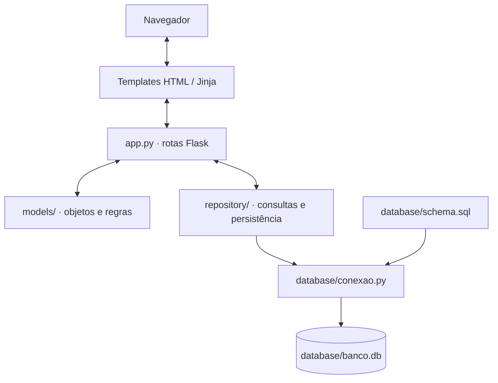

# Arquitetura da aplicação

O MyFlow é organizado em camadas simples. Flask recebe requisições e renderiza templates; os modelos mantêm regras de domínio; os repositórios cuidam da persistência; e o módulo de banco de dados abre conexões SQLite e inicializa o schema.

## Pastas

| Pasta/arquivo | Responsabilidade |
|---|---|
| `app.py` | Rotas HTTP, sessão, validação de formulários, redirecionamentos e coordenação do fluxo |
| `models/` | Classes de domínio e validação dos atributos |
| `repository/` | Operações CRUD e consultas SQLite para cada entidade |
| `database/conexao.py` | Abre conexões, ativa chaves estrangeiras e inicializa/migra o schema |
| `database/schema.sql` | Define tabelas, chaves, restrições e índices |
| `database/corrigir_banco.py` | Migração específica de bancos antigos com restrição única indesejada em `usuarios.curso_id` |
| `templates/` | Páginas Jinja para cadastro, login, curso e disciplinas |
| `static/styles.css` | Estilos da interface da aplicação Flask |
| `uml/` | Fontes PlantUML de diagramas de classes e de sequência |
| `website/` | Portal de documentação Docusaurus |

## Fluxo de dados

1. A rota lê e normaliza dados do formulário.
2. Um modelo é construído ou carregado, aplicando suas validações.
3. O repositório executa operações parametrizadas no SQLite.
4. A camada de aplicação escolhe um template ou redirecionamento.
5. A interface apresenta o resultado.

Os repositórios abrem e fecham suas próprias conexões usando `obter_conexao()`. A aplicação usa o padrão de entrada `python app.py`; nesse caminho, `inicializar_banco()` roda antes do servidor.

## Princípios usados

- **Separação de responsabilidades:** regra do objeto não precisa estar misturada ao SQL da persistência.
- **Validação no modelo:** propriedades validam os valores atribuídos.
- **Consultas parametrizadas:** os repositórios passam valores como parâmetros SQL, evitando concatenar dados do usuário nos comandos.
- **Chaves estrangeiras:** SQLite tem `PRAGMA foreign_keys = ON` por conexão.
- **Progresso separado:** o estado de conclusão pertence à relação entre usuário e disciplina, não ao catálogo compartilhado.
