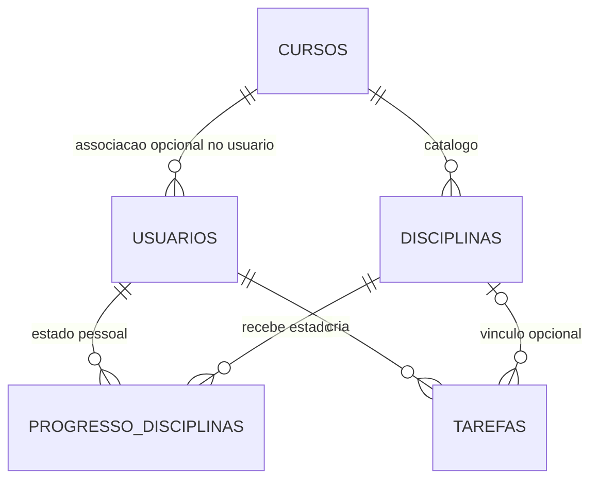

# Banco de dados e migrações

O SQLite é configurado em `database/conexao.py`; conexões possuem `row_factory=sqlite3.Row` e `PRAGMA foreign_keys = ON`. O arquivo físico é `database/banco.db`.

## Schema presente no anexo

| Tabela | Dados principais | Regras |
|---|---|---|
| `usuarios` | Perfil, e-mail, `senha_hash`, `is_owner`, `curso_id` | E-mail único, tempo positivo, papel booleano |
| `cursos` | Nome, nível | Nome único sem diferenciar capitalização |
| `disciplinas` | `curso_id`, código, nome, carga horária | Código único por curso, horas positivas |
| `progresso_disciplinas` | `usuario_id`, `disciplina_id`, `concluida` | PK composta, exclusão em cascata |
| `tarefas` | `usuario_id`, `disciplina_id`, título, prazo, prioridade, duração, conclusão | Tarefa pertencente a usuário, disciplina opcional |
| `schema_migrations` | Versões de migração | Rastreia migrações realizadas |

## Relacionamentos

## Integridade

- `usuarios.curso_id` e `disciplinas.curso_id`: `ON DELETE SET NULL`.
- `progresso_disciplinas.usuario_id` e `disciplina_id`: `ON DELETE CASCADE`.
- `tarefas.usuario_id`: `ON DELETE CASCADE`; `tarefas.disciplina_id`: `ON DELETE SET NULL`.
- `prioridade` admite somente `alta`, `media`, `baixa`; duração de tarefa deve ser maior que zero.

## Inicialização e migrações

`inicializar_banco()` executa `database/schema.sql`, migra atributos antigos (`senha_hash`, `is_owner`) e preserva estados anteriores de disciplina ao passar para o progresso individual (migração `progresso_individual_v1`). Há um script separado `database/corrigir_banco.py` para a restrição legada de curso único por usuário.

:::danger Tabela de tokens ausente
A aplicação consulta `tokens_recuperacao_senha` nas rotas `/esqueci-senha` e `/redefinir-senha/<token>`, mas o `database/schema.sql` **não contém um CREATE TABLE para ela** e `inicializar_banco()` também não a cria. Uma instalação nova não terá a tabela e essas rotas não completarão o fluxo. Corrija schema e migração antes de validar essa funcionalidade; faça backup antes de alterações no banco.
:::
