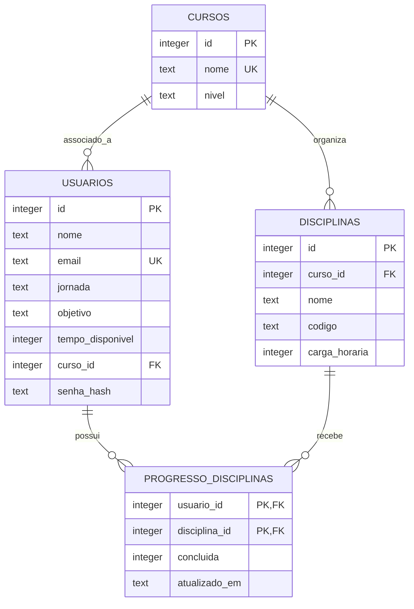

# Banco de dados e migrações

A persistência é feita em SQLite. `database/conexao.py` define o caminho `database/banco.db`, abre conexões, configura `sqlite3.Row` e ativa `PRAGMA foreign_keys = ON` em cada conexão.

## Tabelas

| Tabela | Conteúdo | Restrições importantes |
|---|---|---|
| `usuarios` | Perfil, e-mail, tempo disponível, hash da senha e `curso_id` | E-mail único sem diferenciar maiúsculas/minúsculas; tempo maior que zero; referência opcional a `cursos` |
| `cursos` | Nome e nível do curso | Nome único sem diferenciar maiúsculas/minúsculas |
| `disciplinas` | Nome, código, carga horária e `curso_id` | Carga horária maior que zero; código único dentro do mesmo curso |
| `progresso_disciplinas` | Conclusão individual | Chave primária composta `(usuario_id, disciplina_id)`; conclusão 0 ou 1 |
| `schema_migrations` | Controle de migrações aplicadas | `versao` como chave primária |

## Relações

## Integridade e exclusão

- `disciplinas.curso_id` referencia `cursos.id` com `ON DELETE SET NULL`.
- `usuarios.curso_id` referencia `cursos.id` com `ON DELETE SET NULL`.
- `progresso_disciplinas.usuario_id` e `disciplina_id` usam `ON DELETE CASCADE`.
- A aplicação cria um índice para `disciplinas.curso_id` e outro para `progresso_disciplinas.disciplina_id`.

## Inicialização automática

A função `inicializar_banco()` executa `schema.sql`, acrescenta `senha_hash` em bases antigas quando necessário e executa a migração única `progresso_individual_v1`. Se o campo legado `disciplinas.concluida` existir, seu estado é copiado para os usuários já associados ao curso.

## Migração específica `corrigir_banco.py`

O script verifica se o banco antigo possui uma restrição `UNIQUE` isolada na coluna `usuarios.curso_id`. Se possuir, recria a tabela preservando IDs e dados, para permitir que vários usuários compartilhem o mesmo curso. Ele deve ser executado somente quando necessário e após backup.

:::warning Dados locais
`database/banco.db` pode conter dados reais de desenvolvimento. Ele é ignorado pelo Git e deve ficar fora dos pacotes de documentação. Não apague nem substitua esse arquivo antes de fazer uma cópia de segurança.
:::
