# Modelos de domínio

As classes em `models/` implementam atributos, validações por *properties* e comportamentos do MyFlow. O sistema usa **seis modelos/classes de domínio**, sendo que `SugestorDeTarefas` concentra uma regra de recomendação.

## `Usuario` — `usuarios.py`

Atributos: `id`, `nome`, `email`, `jornada`, `objetivo`, `tempo_disponivel` (minutos), `senha_hash`, `is_owner` e `curso`. Um usuário possui no máximo um curso. Métodos: `definir_curso()`, `remover_curso()`, `atualizar_tempo_disponivel()`, `exibir_ficha()`, `to_dict()`, `__repr__()`.

## `Curso` — `cursos.py`

Atributos: `id`, `nome`, `nivel`, `disciplinas` (lista). Métodos: `adicionar_disciplina()`, `remover_disciplina()`, `buscar_disciplina()`, `calcular_carga_horaria_total()`, `exibir_ficha()`, `to_dict()`. Um catálogo de curso pode ser compartilhado entre contas.

## `Disciplina` — `disciplinas.py`

Atributos: `id`, `nome`, `codigo`, `carga_horaria` (horas). Não armazena conclusão individual nem professor. Métodos: `exibir_ficha()`, `to_dict()`, `__repr__()`.

## `ProgressoDisciplina` — `progresso_disciplina.py`

Atributos: `usuario_id`, `disciplina_id`, `concluida`. Métodos: `concluir()`, `reabrir()`, `to_dict()`, `__repr__()`. Seu estado pertence ao par usuário-disciplina.

## `Tarefa` — `tarefa.py`

| Atributo | Regra |
|---|---|
| `id` | `None` antes da gravação ou inteiro positivo |
| `usuario_id` | Inteiro positivo; proprietário da tarefa |
| `disciplina_id` | Opcional e, quando definido, pertencente ao curso do usuário |
| `titulo` | String não vazia |
| `descricao` | String, podendo ser vazia |
| `prazo` | Data ISO `AAAA-MM-DD` ou `None` |
| `prioridade` | `alta`, `media` ou `baixa` |
| `duracao_estimada` | Inteiro positivo em minutos |
| `concluida` | Booleano, inicialmente `False` |
| `criado_em`, `disciplina_nome` | Informações de apoio carregadas do banco |

Métodos: `concluir()`, `reabrir()`, `esta_atrasada()`, `to_dict()`, `__repr__()`.

## `SugestorDeTarefas` — `sugestor_de_tarefas.py`

Atributo: `tempo_disponivel`, inteiro positivo em minutos. Métodos: `filtrar_por_tempo(tarefas)` e `sugerir_proxima_acao(tarefas, hoje=None)`. A lógica privilegia tarefas atrasadas e compatíveis com o tempo disponível. Veja [Sugestão da próxima ação](../guides/sugestor.md).

## Relacionamentos

```mermaid
classDiagram
    class Usuario {
      +id
      +email
      +tempo_disponivel
      +is_owner
      +curso
      +definir_curso()
    }
    class Curso {
      +nome
      +nivel
      +disciplinas
    }
    class Disciplina {
      +codigo
      +carga_horaria
    }
    class ProgressoDisciplina {
      +usuario_id
      +disciplina_id
      +concluida
    }
    class Tarefa {
      +usuario_id
      +disciplina_id
      +prioridade
      +duracao_estimada
      +esta_atrasada()
    }
    class SugestorDeTarefas {
      +tempo_disponivel
      +filtrar_por_tempo()
      +sugerir_proxima_acao()
    }
    Usuario "0..*" --> "0..1" Curso : associa
    Curso "1" o-- "0..*" Disciplina : organiza
    Usuario "1" --> "0..*" ProgressoDisciplina : registra
    Disciplina "1" --> "0..*" ProgressoDisciplina : recebe
    Usuario "1" --> "0..*" Tarefa : cria
    Tarefa "0..*" --> "0..1" Disciplina : vinculada a
    SugestorDeTarefas ..> Tarefa : analisa
```

