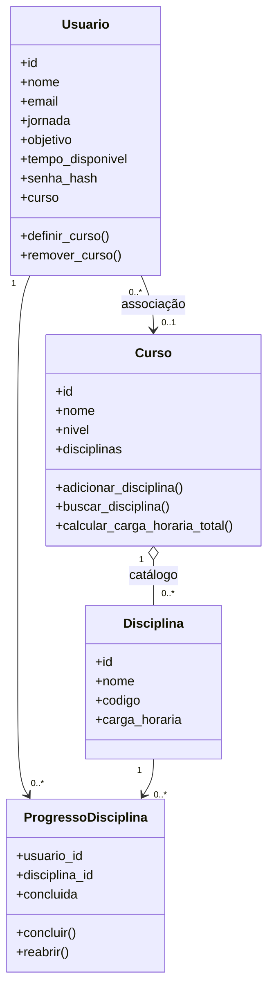

# Modelos de domínio

As classes em `models/` representam os dados e as regras de negócio principais. A maior parte da validação ocorre em `@property` e seus setters; valores inválidos lançam `ValueError`.

## `Usuario` — `models/usuarios.py`

| Atributo | Regra principal |
|---|---|
| `id` | `None` antes da persistência ou inteiro positivo |
| `senha_hash` | `None` ou string não vazia; deve conter hash, não senha pura |
| `nome` | String não vazia, armazenada sem espaços externos |
| `email` | String não vazia que contenha `@`; a unicidade também é imposta pelo banco |
| `jornada` | String não vazia |
| `objetivo` | String não vazia |
| `tempo_disponivel` | Inteiro positivo em minutos; `bool` é rejeitado |
| `curso` | `None` ou objeto `Curso`; usuário possui no máximo um curso associado |

Métodos relevantes: `definir_curso(curso)`, `remover_curso()`, `atualizar_tempo_disponivel(minutos)`, `exibir_ficha()`, `to_dict()` e `__repr__()`. `definir_curso()` retorna `False` se já existir um curso; entradas de tipo inválido geram `ValueError`.

## `Curso` — `models/cursos.py`

| Atributo | Regra principal |
|---|---|
| `id` | `None` ou inteiro positivo |
| `nome` | String não vazia |
| `nivel` | String não vazia |
| `disciplinas` | Lista de objetos `Disciplina`; a leitura devolve uma cópia |

Métodos relevantes: `adicionar_disciplina(disciplina)`, `remover_disciplina(codigo)`, `buscar_disciplina(codigo)`, `calcular_carga_horaria_total()`, `exibir_ficha()`, `to_dict()` e `__repr__()`. A busca de código em memória não diferencia maiúsculas/minúsculas. `adicionar_disciplina()` retorna `False` para código repetido no curso.

## `Disciplina` — `models/disciplinas.py`

| Atributo | Regra principal |
|---|---|
| `id` | `None` ou inteiro positivo |
| `nome` | String não vazia |
| `codigo` | String não vazia |
| `carga_horaria` | Inteiro positivo em horas; `bool` é rejeitado |

Métodos: `exibir_ficha()`, `to_dict()` e `__repr__()`. Na versão atual, a classe não tem atributo `professor` nem atributo `concluida`.

## `ProgressoDisciplina` — `models/progresso_disciplina.py`

| Atributo | Regra principal |
|---|---|
| `usuario_id` | Inteiro positivo |
| `disciplina_id` | Inteiro positivo |
| `concluida` | Booleano `True` ou `False`; começa como `False` |

Métodos: `concluir()`, `reabrir()`, `to_dict()` e `__repr__()`. A classe não acessa o banco diretamente: esse trabalho pertence ao respectivo repositório.

## Relacionamentos

A multiplicidade mostra o comportamento esperado pelo código: um usuário tem zero ou um curso; vários usuários podem compartilhar o mesmo curso; o curso organiza várias disciplinas; e o progresso é registrado para cada usuário-disciplina.
