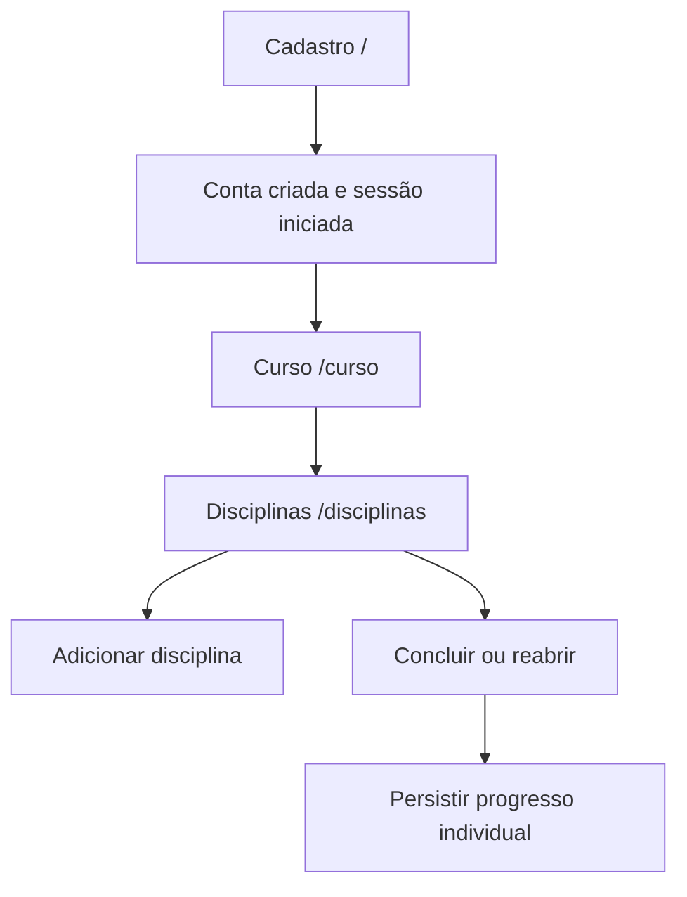

# Jornada de uso

O fluxo principal do MyFlow é dividido em etapas. O servidor mantém a identificação do usuário autenticado na sessão Flask.

## Etapa 1 — Criar uma conta

Na página `/`, a pessoa informa nome, e-mail, jornada de aprendizagem, objetivo, tempo disponível em minutos, senha e confirmação de senha. A aplicação verifica se a senha tem pelo menos oito caracteres, se as duas senhas coincidem e se o e-mail já está cadastrado. A classe `Usuario` também valida os atributos antes de o repositório gravá-los.

Ao concluir o cadastro, a aplicação grava a conta, limpa uma eventual sessão anterior, registra `usuario_id` na sessão e encaminha para `/curso`.

## Etapa 2 — Associar um curso

O usuário informa o nome e o nível do curso. O sistema procura um curso já cadastrado com o mesmo nome. Se encontrar um curso com nível compatível, reutiliza-o; caso contrário, cria um novo. O usuário fica associado a um único curso.

Um curso já existente com o mesmo nome e nível diferente gera uma mensagem de erro, em vez de criar silenciosamente um segundo cadastro com o mesmo nome.

## Etapa 3 — Cadastrar disciplinas

Na página `/disciplinas`, o usuário informa nome, código e carga horária em horas. A carga horária deve ser um inteiro positivo, e o código não pode se repetir dentro do curso.

As disciplinas pertencem ao catálogo do curso. Quando duas pessoas compartilham um curso, veem o mesmo conjunto de disciplinas.

## Etapa 4 — Atualizar o progresso

Para cada disciplina, o usuário pode marcar como concluída ou reabrir a atividade. O estado é salvo na tabela `progresso_disciplinas`, usando `usuario_id` e `disciplina_id`. Assim, o progresso de uma pessoa não altera o de outra.

## Se a pessoa entrar novamente

Em `/login`, após validar as credenciais, o MyFlow direciona para `/curso` se a conta ainda não tiver curso, ou para `/disciplinas` quando já estiver associada a um. Se o ID da sessão não corresponder a um usuário existente, a sessão é limpa e a pessoa volta à tela de login.
