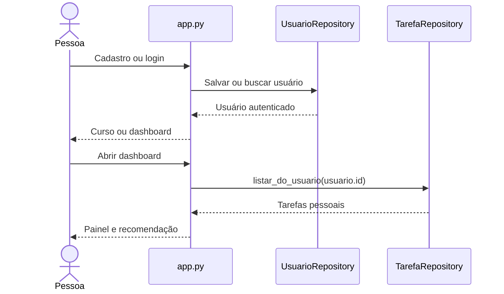

# Jornada de uso

1. **Cadastro** em `/`: nome, e-mail, jornada, objetivo, tempo disponível em minutos e senha de ao menos oito caracteres. Após persistir, a sessão recebe `usuario_id`.
2. **Curso** em `/curso`: selecionar nome e nível. Um curso já existente pode ser reutilizado, desde que o nível corresponda; cada usuário tem no máximo um curso.
3. **Disciplinas** em `/disciplinas`: cadastrar nome, código e carga horária ou marcar a conclusão pessoal; o catálogo de disciplinas é compartilhado entre usuários do mesmo curso.
4. **Painel** em `/dashboard`: visualizar progresso individual das disciplinas, tarefas pendentes e concluídas e uma sugestão de próxima tarefa.
5. **Produtividade** em `/tarefas` e `/agenda`: gerenciar atividades, prazos e prioridade, com associação opcional a disciplinas.
6. **Conta** em `/perfil`: revisar os dados e, quando necessário, trocar e-mail ou senha mediante confirmação da senha atual.

:::info Após novo login
Quem não possui curso é encaminhado para `/curso`; quem já possui vai diretamente para `/dashboard`. A tela de disciplinas continua acessível no menu.
:::
