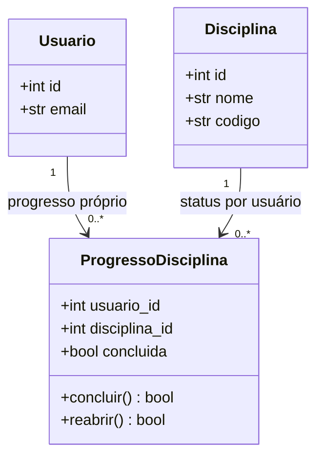

# Progresso individual

A conclusão não é atributo de `Disciplina`. Ela é modelada por `ProgressoDisciplina`, que associa um usuário a uma disciplina e guarda `concluida` como valor booleano.

Essa separação é necessária porque cursos e disciplinas podem ser compartilhados. Se a conclusão fosse gravada no próprio objeto da disciplina, uma pessoa poderia afetar o estado exibido para todas as outras.

## Modelo de dados

A tabela `progresso_disciplinas` tem chave primária composta por `(usuario_id, disciplina_id)`. Isso garante no banco um único registro de progresso por pessoa e disciplina.

## Regras

- Disciplinas sem um registro de progresso para o usuário são consideradas pendentes.
- `concluir()` retorna `True` quando muda de pendente para concluída e `False` quando já estava concluída.
- `reabrir()` retorna `True` quando muda de concluída para pendente e `False` quando já estava pendente.
- O repositório valida se a disciplina pertence ao curso associado ao usuário antes de salvar o progresso.
- O percentual é calculado como `disciplinas concluídas / total de disciplinas × 100`.
- Se o curso não tiver disciplinas, o percentual é `0.0`.

## Migração de dados antigos

`inicializar_banco()` registra a migração `progresso_individual_v1` na tabela `schema_migrations`. Quando encontra o campo legado `disciplinas.concluida`, copia o estado para os usuários associados ao curso no momento da migração. O campo antigo, se presente, não é a fonte utilizada pelo fluxo atual.
