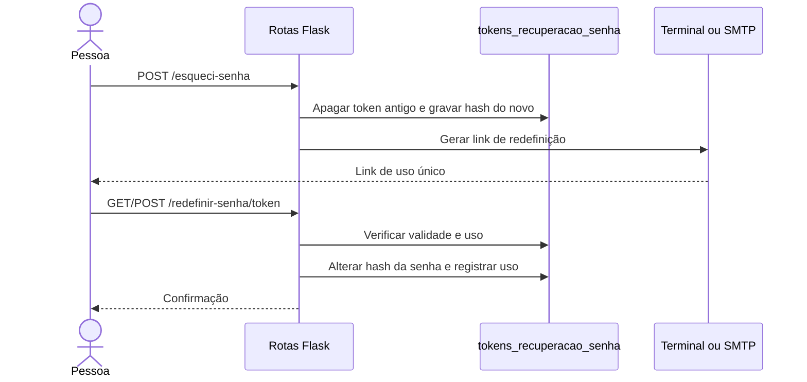

# Recuperação de senha

O código contém interfaces e rotas para pedir um link de redefinição e atualizar a senha. **Contudo, o arquivo `database/schema.sql` do anexo não cria a tabela `tokens_recuperacao_senha` exigida por esse fluxo.** Em um banco novo, a execução falhará quando essas consultas forem usadas, até que o schema seja corrigido.

## Fluxo previsto pelo código

- A aplicação pretende usar token aleatório de uso único, **30 minutos** de validade e apenas o hash do token no banco.
- A tela mostra resposta genérica sem confirmar se o e-mail existe.
- Há uma limitação local de **2 minutos** entre solicitações pelo mesmo endereço, mantida em memória de processo (não é controle persistente).
- Sem `MYFLOW_SMTP_HOST`, o link é impresso no terminal da aplicação; quando configurado, o app usa SMTP (por padrão, porta 587 e STARTTLS).

## Dependências para funcionar

1. Corrigir a criação/migração da tabela `tokens_recuperacao_senha` com os campos usados pelo código e validar essa mudança em banco temporário.
2. Configurar SMTP opcionalmente, conforme [Variáveis de ambiente](../getting-started/configuracao.md).
3. Testar solicitação, expiração, reutilização de token e troca de senha sem expor os links em logs compartilhados.

:::danger Situação observada no ZIP
O arquivo `GUIA_LOGIN_ADMINISTRACAO.md` menciona `.env.example`, mas **esse arquivo também não está presente no pacote mais recente**. Não presuma que copiar esse arquivo seja possível; crie seu `.env` manualmente quando necessário. Esta atualização é da **documentação** e não altera a implementação ou o banco Flask.
:::
