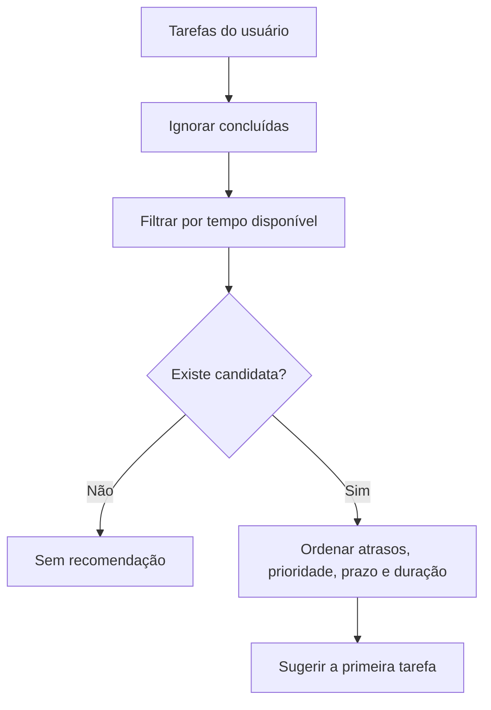

# Sugestão da próxima ação

`models/sugestor_de_tarefas.py` contém a classe `SugestorDeTarefas`. Ela utiliza **regras simples** e não depende de inteligência artificial externa.

## Algoritmo da versão atual

1. Recebe o tempo disponível do usuário, em minutos, como inteiro positivo.
2. Filtra tarefas **não concluídas** cuja `duracao_estimada <= tempo_disponivel`.
3. Ordena por: **(a)** estar atrasada primeiro; **(b)** prioridade `alta`, `media`, `baixa`; **(c)** prazo mais próximo; **(d)** menor duração; **(e)** título em ordem alfabética como desempate.
4. Retorna a primeira tarefa da lista ordenada ou `None` quando não há candidatas.

## Exemplo ilustrativo

Com **30 minutos livres**, uma tarefa de prioridade alta estimada em **60 minutos** não entra na seleção; uma tarefa de 20 minutos pode ser sugerida. Entre duas candidatas, uma **atrasada** tem precedência mesmo que a outra possua prioridade alta.

:::note Limitação
O algoritmo não divide automaticamente tarefas longas e não considera dependências entre atividades, energia, horário do dia ou notificações. O tempo disponível é uma estimativa informada no perfil.
:::
