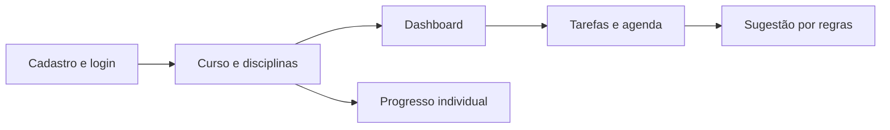

# MyFlow, por dentro

O **MyFlow** organiza a jornada de estudos por meio de cursos, disciplinas, tarefas e prioridades. O portal documenta a implementação em **Python, Flask e SQLite**, incluindo o painel do usuário, a agenda, o sugestor por regras e as funcionalidades de conta.

<strong>Documentação baseada no código</strong>
Atualizada para o projeto recebido em novembro de 2026. As funcionalidades existentes são diferenciadas das lacunas de implementação. O aplicativo Flask e este portal Docusaurus são sistemas independentes.

  <a className="doc-link-card" href="/docs/product/visao-geral">01 · Produto<strong>Funcionalidades</strong>Conheça o escopo atual, os perfis e as principais telas.</a>
  <a className="doc-link-card" href="/docs/guides/tarefas">02 · Produtividade<strong>Tarefas e agenda</strong>Crie tarefas, defina prioridades e acompanhe os prazos.</a>
  <a className="doc-link-card" href="/docs/getting-started/instalacao">03 · Execução<strong>Executar localmente</strong>Inicie Flask e o portal de documentação sem misturar os ambientes.</a>
  <a className="doc-link-card" href="/docs/architecture/arquitetura">04 · Engenharia<strong>Arquitetura e UML</strong>Entenda modelos, repositórios, rotas e dados.</a>

## Módulos documentados

| Módulo | Conteúdo |
|---|---|
| Aprendizagem | Cadastro, curso compartilhado, disciplinas e progresso individual |
| Produtividade | Dashboard, tarefas pessoais, sugestão da próxima ação e agenda |
| Conta | Login, perfil, troca de credenciais e controle de sessão |
| Administração | Ativação de proprietário, papéis e gerenciamento de contas |
| Recuperação | Rotas de redefinição e configuração SMTP; **dependência de tabela ausente no schema anexado** |

## Jornada resumida

:::warning Antes de executar a recuperação de senha
O código fornecido consulta a tabela `tokens_recuperacao_senha`, ausente do `database/schema.sql` fornecido. Consulte [Limitações e pendências](./reference/seguranca-e-limitacoes.md) antes de testar esse recurso em um banco novo.
:::
