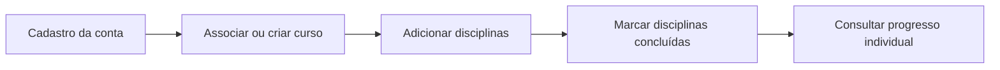

# MyFlow, por dentro

O MyFlow é um protótipo web acadêmico que permite cadastrar uma conta, associar um curso, organizar as disciplinas desse curso e acompanhar a conclusão de cada disciplina individualmente.

  <strong>O que esta documentação cobre</strong>
  
O comportamento descrito aqui foi baseado nos arquivos do projeto anexado: aplicação Flask, modelos, repositórios, templates, schema SQLite e fontes UML. Funcionalidades planejadas mas ainda não implementadas são identificadas como tal.

## Comece pelo seu objetivo

  <a className="doc-link-card" href="/docs/product/visao-geral">01 · Produto<strong>Entender o MyFlow</strong>Escopo implementado, conceitos principais e limites atuais.</a>
  <a className="doc-link-card" href="/docs/getting-started/instalacao">02 · Execução<strong>Rodar localmente</strong>Ambiente Python, dependências, banco e servidor Flask.</a>
  <a className="doc-link-card" href="/docs/architecture/arquitetura">03 · Engenharia<strong>Conhecer a arquitetura</strong>Como interface, modelos, repositórios e SQLite se conectam.</a>
  <a className="doc-link-card" href="/docs/reference/uml">04 · Diagramas<strong>Explorar o UML</strong>Diagramas de classes e de sequência com os arquivos-fonte.</a>

## Visão rápida

| Elemento | Tecnologia ou responsabilidade |
|---|---|
| Aplicação web | Flask, com rotas para cadastro, login, curso e disciplinas |
| Interface | Templates HTML/Jinja e `static/styles.css` |
| Domínio | `Usuario`, `Curso`, `Disciplina` e `ProgressoDisciplina` |
| Persistência | SQLite, acessado por classes de repositório |
| Segurança de senha | Hash de senha por `werkzeug.security` |
| Documentação | Docusaurus e Markdown/MDX |

## Fluxo principal

:::info Sobre o escopo
O projeto guarda o tempo disponível informado no cadastro, mas a versão anexada ainda não contém classes de tarefas, sessões de estudo nem um mecanismo que sugira a próxima ação. Consulte [Visão geral do produto](./product/visao-geral.md) para distinguir as funcionalidades existentes das ideias futuras.
:::
