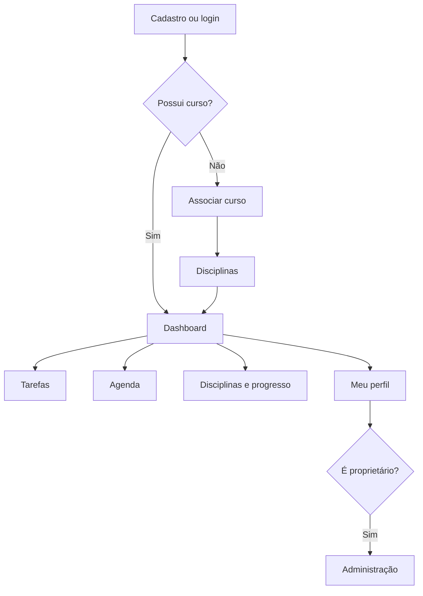

# Visão geral do produto

O MyFlow é um sistema web acadêmico de organização de estudos. Cada usuário vincula **no máximo um curso**, que pode ser compartilhado com outras contas. As disciplinas pertencem ao curso; **tarefas e progresso são individuais**.

## Funcionalidades presentes no código

| Área | Recursos |
|---|---|
| Conta | Cadastro com jornada, objetivo, tempo diário, e-mail e senha; login e saída |
| Curso e disciplinas | Criação/reutilização de curso, cadastro de disciplinas e conclusão por usuário |
| Dashboard | Progresso do curso, quantidades de tarefas e proposta da próxima ação |
| Tarefas | Criar, listar, editar, concluir, reabrir e excluir; disciplina opcional |
| Agenda | Listagem por prazo e sinalização das tarefas atrasadas |
| Sugestor | Seleção de tarefa pendente dentro do tempo disponível, ordenada por regras |
| Perfil | Alterar dados, tempo diário, e-mail e senha; confirmação de senha atual em mudanças sensíveis |
| Proprietário | Ativação inicial por token e gerenciamento de outras contas/papéis |
| Recuperação | Formulários e fluxo com token e SMTP, **mas schema de tokens incompleto no anexo** |

## Caminhos de navegação

## Limites desta versão

Não há divisão de tarefas em subtarefas, sessões cronometradas de estudo, sincronização externa de calendário nem motor de IA generativa. O `SugestorDeTarefas` aplica uma ordenação determinística, não consulta serviço externo. A recuperação de senha **não está pronta em instalações novas** enquanto a tabela necessária não for criada. Consulte [Segurança e limitações](../reference/seguranca-e-limitacoes.md).
