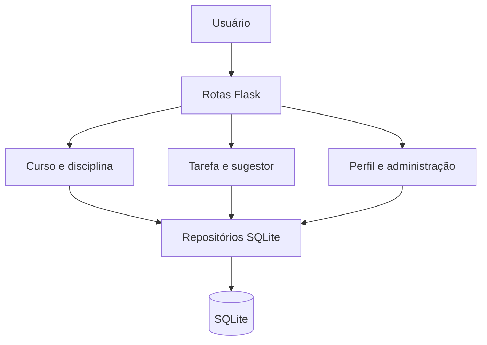

# Diagramas UML

Diagramas Mermaid são exibidos diretamente nas páginas. Os arquivos `.puml` são **fontes PlantUML editáveis**, publicados em `static/uml/` e mantidos também no diretório `uml/` do projeto.

## Visão integrada

## Classes existentes

| Arquivo | Escopo |
|---|---|
| [Visão geral](/uml/classes/00_myflow_geral.puml) | Modelos, repositórios e relacionamento com banco |
| [Disciplina](/uml/classes/01_models_disciplinas.puml) | Dados e validação de disciplina |
| [Curso](/uml/classes/02_models_cursos.puml) | Lista e catálogo de disciplinas |
| [Usuário](/uml/classes/03_models_usuarios.puml) | Perfil, curso e regras do usuário |
| [Repo. disciplinas](/uml/classes/04_repository_disciplinas.puml) | Persistência de disciplinas |
| [Repo. cursos](/uml/classes/05_repository_cursos.puml) | Persistência do curso |
| [Repo. usuários](/uml/classes/06_repository_usuarios.puml) | Persistência de contas |
| [Progresso individual](/uml/classes/07_models_progresso_disciplina.puml) | Estado usuário-disciplina |
| [Repo. progresso](/uml/classes/08_repository_progresso_disciplina.puml) | Consulta e cálculo de conclusão |
| [Tarefa — novo](/uml/classes/09_models_tarefa.puml) | Atributos e comportamentos de tarefas |
| [Sugestor — novo](/uml/classes/10_models_sugestor_de_tarefas.puml) | Regras de recomendação |
| [Repo. tarefas — novo](/uml/classes/11_repository_tarefas.puml) | CRUD pessoal e filtros |

## Sequências

| Arquivo | Fluxo |
|---|---|
| [Cadastro](/uml/sequencia/07_sequencia_cadastro_usuario.puml) | Persistência de usuário e sessão |
| [Curso e disciplinas](/uml/sequencia/08_sequencia_cadastro_curso_disciplinas.puml) | Associação e cadastro |
| [Login](/uml/sequencia/09_sequencia_login.puml) | Autenticação |
| [Progresso individual](/uml/sequencia/10_sequencia_progresso_individual.puml) | Concluir/reabrir disciplinas |
| [Perfil e administração — novo](/uml/sequencia/11_sequencia_perfil_administracao.puml) | Perfil, proprietário e gerenciamento de contas |
| [Tarefas, sugestão e agenda — novo](/uml/sequencia/12_sequencia_tarefas_sugestao_agenda.puml) | CRUD de tarefas, seleção da próxima ação e visualização de prazos |

:::note Interpretação
Diagramas de sequência descrevem um caminho representativo do código; a documentação de segurança registra as condições que impedem ou limitam certos fluxos, como a recuperação de senha no schema fornecido.
:::
