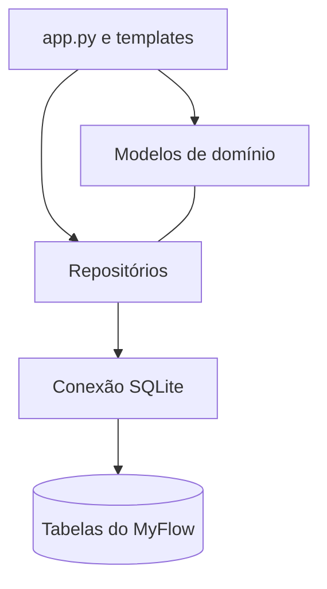

# Diagramas UML

O repositório contém fontes PlantUML de classes e de sequência na pasta `uml/`. Os arquivos também são publicados como downloads estáticos pelo portal, em `website/static/uml/`.

## Diagrama de arquitetura resumido

## Diagramas de classes

| Arquivo | Conteúdo |
|---|---|
| [00 · MyFlow geral](/uml/classes/00_myflow_geral.puml) | Visão do domínio, repositórios e banco |
| [01 · Modelo Disciplina](/uml/classes/01_models_disciplinas.puml) | Atributos e métodos de `Disciplina` |
| [02 · Modelo Curso](/uml/classes/02_models_cursos.puml) | Curso e sua lista de disciplinas |
| [03 · Modelo Usuario](/uml/classes/03_models_usuarios.puml) | Perfil, associação ao curso e regras |
| [04 · Repositório de disciplinas](/uml/classes/04_repository_disciplinas.puml) | Persistência de disciplinas |
| [05 · Repositório de cursos](/uml/classes/05_repository_cursos.puml) | Persistência de cursos e sincronização de disciplinas |
| [06 · Repositório de usuários](/uml/classes/06_repository_usuarios.puml) | Persistência e consulta de usuários |
| [07 · Modelo de progresso](/uml/classes/07_models_progresso_disciplina.puml) | Estado individual por usuário e disciplina |
| [08 · Repositório de progresso](/uml/classes/08_repository_progresso_disciplina.puml) | Consulta, gravação e cálculo do progresso |

## Diagramas de sequência

| Arquivo | Fluxo |
|---|---|
| [07 · Cadastro de usuário](/uml/sequencia/07_sequencia_cadastro_usuario.puml) | Validação, hash, persistência e criação da sessão |
| [08 · Curso e disciplinas](/uml/sequencia/08_sequencia_cadastro_curso_disciplinas.puml) | Reutilizar curso, inserir disciplinas e persistir |
| [09 · Login](/uml/sequencia/09_sequencia_login.puml) | Busca do usuário, verificação da senha e redirecionamento |
| [10 · Progresso individual](/uml/sequencia/10_sequencia_progresso_individual.puml) | Concluir/reabrir e salvar estado individual |

Os links disponibilizam os arquivos `.puml` originais para download ou edição. Para renderizá-los, use uma extensão PlantUML no editor ou uma ferramenta compatível. Os diagramas Mermaid desta página são versões simplificadas para leitura direta no navegador.

:::note Manutenção
Quando o código mudar, revise o diagrama de classes correspondente e os diagramas de sequência afetados. O diagrama é documentação do comportamento existente e deve acompanhar as alterações relevantes.
:::
